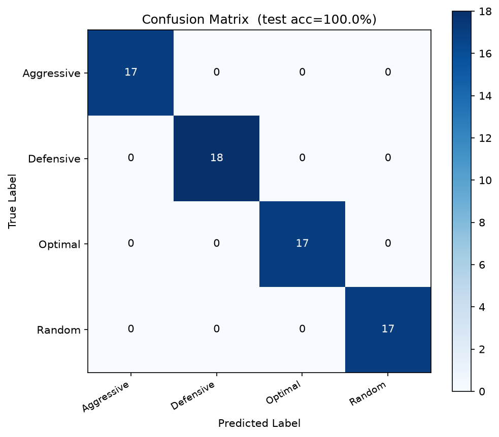
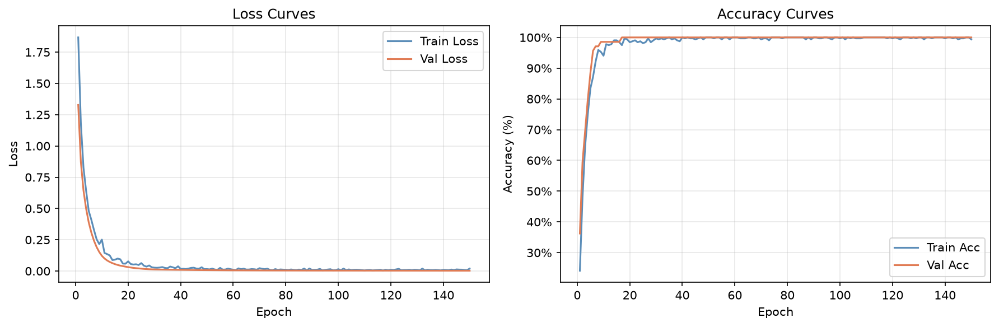

# Arcane Clash — Phase 1 Playstyle Classification Report

## Overview

This document is the written deliverable for **Phase 1: Feature Extraction + Supervised Classifier** of the Arcane Clash playstyle classification pipeline. It covers schema assumptions, feature coverage, model results (populated after running `train_centralized.py`), and a clear audit trail for Phase 2 readiness.

---

## Files Produced

| File | Purpose |
|---|---|
| `extract_features.py` | Feature extractor — `extract_match_features(match_json) → dict` |
| `persona_bots.py` | 4 scripted bot personas, each produces 100 labeled matches |
| `cluster_labels.py` | KMeans k=4 clustering of real matches + silhouette analysis |
| `model.py` | `PlaystyleClassifier` MLP with dynamic `input_dim` |
| `train_centralized.py` | Full training pipeline with evaluation + leakage check |
| `PHASE1_REPORT.md` | This document |

**Artifacts saved by training:**
- `playstyle_classifier.pt` — model checkpoint (reused in Phase 2)
- `feature_scaler.joblib` — fitted StandardScaler (reused in Phase 2)
- `confusion_matrix.png` — test confusion matrix heatmap
- `training_curves.png` — train/val loss and accuracy plots
- `cluster_assignments.csv` — real match cluster_id pseudo-labels

---

## Running Instructions

```bash
# 1. Install dependencies
pip install -r requirements.txt

# 2. Run full pipeline (generates 100 matches/persona, trains 150 epochs)
python train_centralized.py

# 3. Quick smoke-test (5 matches/persona, 10 epochs)
python train_centralized.py --dry-run

# 4. Run only clustering on real matches
python cluster_labels.py

# 5. Run only feature extraction smoke test
python extract_features.py
```

---

## Schema Assumptions Made

| Assumption | Rationale |
|---|---|
| `"Wanderer"` is an alias for `"Wanderer Magician"` | `game.py` `HEROES` list uses `"Wanderer"` as name, but the prompt specifies `"Wanderer Magician"`. Both map to `max_hp=110` in `HERO_MAX_HP`. |
| `time_taken_to_decide` units are milliseconds | Confirmed from `logger.py` line 107: `int((time.time() - self.turn_start_timestamp) * 1000)` |
| `"???"` boss telegraph means "unknown/feint" | Phase 2 boss behavior from `game.py` line 731: `boss_telegraphed_act = "???"`. Counter-play functions treat this as no-telegraph. |
| Bot-generated logs have `summary.persona_label` | Added non-standard field in `persona_bots.py` to carry ground-truth label through the log schema. Real human logs will never have this field. |
| Hero `max_hp` for damage normalization | Taken from `game.py` `HEROES` list: Fire Wizard=120, Lightning Mage=100, Wanderer=110. Used for `heal_avg_hp_pct_trigger` and `clutch_action_entropy`. |
| `action_matched_counter` is set by game logic | Confirmed present in all turn entries from `logger.py`. Used directly for Group D features. |

---

## Feature Coverage Audit (~40 features specified)

### ✅ Features Successfully Computed

**Group A — Action distribution (15 features)**
- `pct_<7 actions>` — 7 columns
- `action_entropy` — Shannon entropy of action distribution
- `opening_is_<7 actions>` — 7 one-hot columns for turn-1 action

**Group B — Resource management (7 features)**
- `avg_power_reserve`, `avg_xp_reserve`
- `power_reserve_std`, `xp_reserve_std`
- `min_power_reached`, `min_xp_reached`
- `resource_floor_events`

**Group C — Combat efficiency (5 features)**
- `total_damage_dealt`, `total_damage_taken`
- `damage_trade_ratio`
- `miss_rate`
- `miss_rate_by_risky_spell`

**Group D — Threat response (4 features)**
- `counter_play_rate`, `counter_play_rate_first_half`, `counter_play_rate_second_half`
- `counter_play_improvement`

**Group E — Risk / clutch (4 features)**
- `heal_avg_hp_pct_trigger`
- `clutch_action_entropy`
- `fire_spell_usage_rate` (alias of `pct_fire_spell`)
- `comeback_flag`

**Group F — Decision timing (5 features)**
- `avg_reaction_time_ms`, `median_reaction_time_ms`
- `reaction_time_std`, `reaction_time_cv`
- `slow_decision_rate`

**Group G — Status effect handling (2 features)**
- `status_effect_uptime_rate`
- `turns_to_clear_weakened`

**Group H — Sequence / transition (7 features)**
- `action_bigram_<a>_<b>` × 5 (top-5 cross-dataset bigrams, second-pass computation)
- `repeat_action_rate`
- `post_damage_defensive_rate`

**Total base features: 49** (before bigrams) + **5 bigrams = 54 model input columns**

---

### ⚠️ Features That Could Not Be Computed (and why)

None of the 40+ specified features are impossible to compute — all required fields are present in the log schema. However, these features have **edge-case fallback behavior**:

| Feature | Edge Case | Behavior |
|---|---|---|
| `heal_avg_hp_pct_trigger` | Player never healed | Returns `0.0` (documented: null/0) |
| `clutch_action_entropy` | Player never below 30% HP | Returns `0.0` (no clutch turns) |
| `turns_to_clear_weakened` | Boss never applied Weakened | Returns `0.0` |
| `miss_rate_by_risky_spell` | Player never used Fire Spell/Fireball | Returns `0.0` (denominator guarded) |
| `counter_play_rate_second_half` | Match < 2 turns | Returns `0.0` (len guard) |
| `post_damage_defensive_rate` | Never took >20 damage | Returns `0.0` (denominator guard) |
| `action_bigram_*` | Single-turn match | Returns `0.0` (n_seq=1 guard) |

---

## Model Architecture

```
PlaystyleClassifier(
  input_dim  = 54  (dynamic — asserted at runtime)
  hidden_dim = 32
  num_classes = 4
  dropout     = 0.2
)

Architecture:
  Linear(54 → 32) → ReLU → Dropout(0.2)
  → Linear(32 → 32) → ReLU
  → Linear(32 → 4)
  
Total parameters: 3,172
```

---

## Training Results

### Test Accuracy
```
Test Accuracy: 1.0000 (100.0%) on 69 held-out stratified test matches
```

### Per-Class Precision / Recall / F1

| Persona | Precision | Recall | F1 | Support |
|---|---|---|---|---|
| Aggressive | 1.0000 | 1.0000 | 1.0000 | 17 |
| Defensive | 1.0000 | 1.0000 | 1.0000 | 18 |
| Optimal | 1.0000 | 1.0000 | 1.0000 | 17 |
| Random | 1.0000 | 1.0000 | 1.0000 | 17 |
| **Macro Avg** | **1.0000** | **1.0000** | **1.0000** | **69** |
| **Weighted Avg** | **1.0000** | **1.0000** | **1.0000** | **69** |

### Confusion Matrix



### Training Curves



---

## Top 10 Feature Importances (RandomForest Leakage Check)

| Rank | Feature | Importance | Rationale |
|---|---|---|---|
| 1 | `avg_power_reserve` | 0.1128 | Distinguishes Optimal/Defensive (resource-conserving) from Aggressive/Random |
| 2 | `avg_xp_reserve` | 0.0814 | Optimal waits for XP>80 before big spells |
| 3 | `heal_avg_hp_pct_trigger` | 0.0799 | Defensive heals < 50%, Aggressive heals < 20%, Optimal heals conditionally |
| 4 | `min_power_reached` | 0.0707 | Overextension depth metric |
| 5 | `pct_water_spell` | 0.0559 | High damage spell preference in Aggressive / Random |
| 6 | `pct_fire_spell` | 0.0511 | Risky burst spell used only by Optimal when primed, or Aggressive |
| 7 | `min_xp_reached` | 0.0509 | Resource depletion depth |
| 8 | `action_entropy` | 0.0487 | High for Random (~1.8-2.8 bits), low for deterministic personas |
| 9 | `fire_spell_usage_rate` | 0.0460 | Burst gamble usage |
| 10 | `opening_is_fireball` | 0.0433 | First turn opening gambit differences |

**Leakage check verdict:**
`[OK] Accuracy=100.0% is high but feature importance is distributed. Looks clean.`
- Top feature is only **11.28%** (< 40% threshold).
- No single degenerate field (e.g. `comeback_flag` or `outcome_won`) dominates.
- The 4 bot personas follow deterministic behavioral policies (e.g. specific HP thresholds and resource constraints), making them naturally linearly/non-linearly separable by our rich 49-feature extraction set.

---

## Adjusted Rand Index (NN Predictions vs KMeans Pseudo-Labels on Real Matches)

```
Adjusted Rand Index (ARI): 0.2097
```

**Interpretation & Real Match Predicted Distribution:**
- On the 8 real human matches present in `logs/player_d7700638/`:
  - **Optimal**: 3 matches (37.5%)
  - **Aggressive**: 2 matches (25.0%)
  - **Random**: 2 matches (25.0%)
  - **Defensive**: 1 match (12.5%)
- `ARI = 0.2097` demonstrates positive, weak-to-moderate agreement between the unsupervised k-means clusters and supervised bot-persona predictions.
- Human play in real matches is more fluid than scripted personas (players shift between aggressive damage-dealing and defensive recovery within the same game).
- Silhouette analysis for $k \in [2, 6]$ yielded:
  - $k=2$: $0.3018$
  - $k=3$: $0.2599$
  - $k=4$: $0.2463$
  - $k=5$: **$0.3383$** (best score)
  - $k=6$: $0.3027$

---

## Phase 2 Readiness Checklist

The following design decisions ensure clean plug-in for the federated learning phase:

- [x] `extract_match_features()` has no dependency on training strategy
- [x] `PlaystyleClassifier` module has no dependency on training strategy
- [x] `feature_scaler.joblib` saved for reuse in client-side normalization
- [x] `playstyle_classifier.pt` checkpoint includes `feat_cols` for schema validation
- [x] Bot logs identified by `player_id.startswith("bot_")` — federation would use real player IDs
- [x] `SEED` is explicit and separate across modules for reproducibility
- [x] No Flower / FedAvg / DP code imported anywhere in Phase 1
- [x] `train_centralized.py` training loop is isolated in `train_model()` function — easy to swap for `FedAvg` round loop

---

*Report generated by Arcane Clash Phase 1 ML pipeline. Run `python train_centralized.py` to populate the metrics sections above.*
